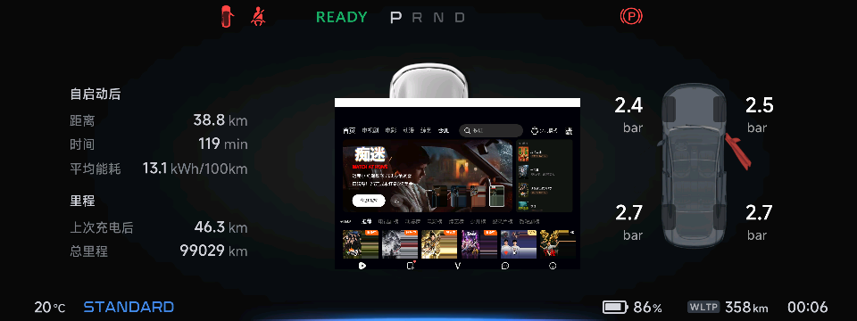

# xpeng-vd-mirror

把车机上的一个屏幕区域（默认 QQ 音乐歌词页）实时镜像到仪表的前景层，原车的报警灯、指针、边框、左右卡片都不受影响。

- **车机侧**：`SurfaceControl.captureDisplay` 抓虚拟屏 → RGB565 → LZ4 → TCP
- **仪表侧**：i.MX6 / Linux 3.0.35 上的静态接收程序，LZ4 解码后 1:1 贴到 fb1 的指定矩形
- **实测**：车机 62fps 采集与发送同步，仪表稳定 58.6fps（16.7ms 预算内）

> 本仓库只做**画面搬运**这一件事：车机有什么就投什么，仪表侧不参与内容生成本身。
> 仪表上「自己画数字、画卡片、画地图」那一套属于另一条技术路线，已经从这里剥离出去，不在本仓库。

---

## 1. 链路

```
┌──────────── 车机（8295 / Android 12）────────────┐
│  VdSend（app_process + dex，shell 域）            │
│    ├─ 建虚拟屏，把目标窗口搬过去（--mode vd）      │
│    ├─ captureDisplay → Bitmap(RGB565)             │
│    ├─ 色键修正：0x0000 一律抬成 0x0001            │
│    └─ LZ4 block → TCP 172.20.1.40:5560            │
└───────────────────────┬──────────────────────────┘
                        │ 车内 eth0 100Mbps
┌───────────────────────▼──────────────────────────┐
│  icrecv（静态 ELF，/tmp 下运行）                   │
│    ├─ LZ4 解码                                     │
│    ├─ 尺寸一致 → 整行直拷（1:1，不重采样）          │
│    ├─ 只写目标矩形那几行（pwrite /dev/fb1）        │
│    └─ 矩形外区域用 fb0 原内容补回                  │
│  原厂仪表程序继续跑，接收端只借用 fb1 前景层        │
└──────────────────────────────────────────────────┘
```

仪表 `fb0` 是显示控制器扫描输出的只读帧缓冲，`fb1` 才是可写的前景叠加层。像素值 `0x0000` 在 fb1 上是**色键**，透出下层 fb0——这就是「投屏区之外原厂画面完好」的原因，也是发送端必须把纯黑抬成 `0x0001` 的原因（否则正常画面的黑会变成洞）。

## 2. 实测

```
车机  VDS| fps=62 cap=51682 proc=51682 sent=47554 bytes/s=7325523 procMs=5
仪表  frames=2160 58.6fps (recv 550x384) read=1.27ms dec=8.13ms draw=4.57ms flush=3.25ms | total=17.2ms
```

| 阶段 | 帧率 | 说明 |
|---|---|---|
| 起始（v0.1，zlib 全屏带） | 5–8fps | 仪表侧解压就是天花板 |
| v0.6 | 20fps | 换 LZ4、按中间带出帧 |
| v0.9 | 30.1fps | 发送端 `targetFps=30` 卡着，接收端刚好追平 |
| **v1.0** | **58.6fps** | 去掉重复落屏写、按矩形窄写、修 LZ4 匹配补登记 |

58.6 已经贴着这块屏的上限（60Hz 刷新 + 采集端 vsync 对齐），再往上没有意义。

### 剥离自绘 UI 后的复测

把接收端里的卡片绘制（`sprite` / `loadCards` / `//go:embed` 三张 PNG）和
`localmap` / `split` / `jbench` / `fbput` 四个子命令全部拆掉、二进制从 3.40MB
降到 2.36MB 之后，重新推上仪表复测：

```
车机  VDS| fps=62 cap=8590 proc=8590 sent=8322 bytes/s=7917462 procMs=7
仪表  frames=7860 59.9fps (recv 550x384) read=1.08ms dec=7.10ms draw=4.15ms flush=3.46ms | total=15.8ms
```

**59.9–60.5fps，比带卡片的 v1.0 还略高**（卡片绘制本来就在 `cards=0` 路径之外，
省下的主要是代码体积和指令 cache）。`flush` 仍在 3.0–3.4ms，`PWRITEROWS bad=`
零条，7860 帧无衰减。画面见 `shots/v11_verify.png`。

`compose` 的命令行签名没有变，`cards` 参数保留但被忽略 —— 车上装的 APK 已经
把 `compose <port> <hold> <top> <bot> <cards> [x y w h]` 写死，改参数就得连 APK 一起换。



中间是投屏内容，左右两侧的里程、胎压、车模全部完好，边缘没有黑洞或错位。

## 3. 目录

```
asx/                  车机端 dex 源码（VdSend 发送端 + 各阶段诊断类 VdCap*/VdTok*）
adbprobe/             控制台 APK（面板 UI、裁切框选、RPC、预览，内置上面两端产物）
vdtest/               最小 captureDisplay 验证 APK
tools/icrecv2/        仪表端接收程序（Go，交叉编译成 ARMv7 静态 ELF）
tools/                运维脚本（起停、部署、安装、状态）
tools/remote/         远端执行的小脚本（killvds.sh 等）
probe/                仪表 30510 管理通道的 Python 工具（RPC、抓图、取放文件）
docs/                 实现总览、控制器说明、三个阶段的实验记录
shots/                现场截图
```

`adbprobe/assets/` 里的 `icrecv_dbg`、`vd.dex` 是**上一次构建的产物**，入库是为了让 APK 在不装 Go / JDK 的机器上也能直接重建；源码改动后请按下一节重新生成。

## 4. 构建

```bash
# 车机端 dex
bash asx/build.sh                  # -> asx/build/dex/classes.dex

# 仪表端接收程序
bash tools/icrecv2/build.sh        # -> tools/icrecv2/icrecv_dbg（ELF32 ARM，纯静态）

# 控制台 APK（会先重编接收端与 dex，再打进 assets）
bash asx/build.sh && bash adbprobe/build.sh
```

依赖：JDK 17 + Android SDK build-tools（路径写在各 `build.sh` 顶部，按自己机器改）、Go 1.22+。

装到车上：

```bash
bash tools/installapk.sh adbprobe/AdbProbe.apk com.probe.adbprobe adbprobe.apk
```

这台 ROM 会拦 `adb install`（`isPlatSigned:false`），只能走图形安装器 + 键盘导航，脚本已经把这条路固化。

## 5. 运行

```bash
bash tools/startcast.sh vd 60      # vd=虚拟屏模式，60fps
bash tools/status.sh               # 看两端速率
bash tools/stopcast.sh             # 停（仪表自动还原原版面）
```

调整投屏矩形（热生效）：

```bash
adb shell "echo '960,345,1440,426' > /data/local/tmp/vdcrop.txt"   # 车机侧裁切
# 仪表侧目标矩形由 APK 传入：compose <port> <hold> <top> <bot> <cards> [x y w h]
```

`cards` 参数保留只为兼容 APK 已固化的命令行，本仓库已不绘制任何卡片，恒传 `0`。

## 6. 几个绕不过去的坑

**车机端必须 shell 域启动。** 用售后域 root（`u:r:xpaftersalesd:s0`）启动时，`captureDisplay` 约 330 次后恒返回 null、`ProcessBuilder` 起 screencap 几十次后报 `error=13`；同一个 dex 在 shell 域下 1500 次零失败。

**落屏只认 pwrite。** mmap 的 fb 区域与硬件实际扫描的显存可能不一致，写完 mmap 再 pwrite 才是双倍开销；pwrite 单独就够。

**别在仪表上调 `time.Now()` 做分项计时。** 内核 3.0.35 的时钟源偶发跳变，会出现「某个分项 36 秒、而整帧 16.4ms」这种自相矛盾的数字。判断性能只信 `total`（与 `frames/elapsed` 同量纲、互相自洽）。

**LZ4 压缩器不要给匹配区间补登记。** 画面里大片渐变/纯色的匹配长度动辄几百字节，逐位置重新 hash 等于整帧算两遍。这一项就让发送线程从 62fps 掉到 47fps。

**仪表端 `nc` 一次连接最多落 65536 字节。** 超过这个量的部分静默丢弃，`rc` 仍是 0。
同一块 2.36MB 的二进制：整包 wget 停在 61440 B、`nc` 传 400KB 只落 397312、
传 128KB 只落 65536 —— 都是这同一个 64KB socket 缓冲上限。往仪表送文件必须
切块（本仓库用 `probe/pushmulti.py`，60000 字节/块），而且**每块都要校验落盘长度**，
否则拼接出来的是错位文件，装上去只会 `Exec format error`。

**`adb server` 会被周期性回收，脚本里的 adb 调用会静默失败。** 表现是
`no devices/emulators found`，但被 `capture_output` 吞掉后只剩「一块都没传进去」。
每次 adb 调用前都要检查并在失败时 `start-server` + `connect`，不能只在脚本开头连一次。

## 7. 环境

| | |
|---|---|
| 车机 | 小鹏 E28U / 8295 / Android 12 |
| 仪表 | i.MX6 Dual / ARMv7 / Linux 3.0.35 / fb1 RGB565 1920×720 |
| 网络 | 车机 `eth0 172.20.1.45` → 仪表 `172.20.1.40:5560`；adb 走车机 `wlan0` |
| 仪表管理通道 | `172.20.1.40:30510`，无鉴权 root shell |

## 8. 致谢

这条链路不是凭空设计出来的，两个公开项目的前期研究给了决定性参考：

**[heavendoorx7 / OP-Ultra](https://github.com/zgaiss/OP-Ultra)**（原始作者 [heavendoorx7](https://github.com/heavendoorx7)，[zgaiss](https://github.com/zgaiss) 有可读的复刻）
老款 P7 E28 的 CarPlay 与仪表融合研究。它把仪表侧的做法定成了这样一条骨架：Android 端合成整幅画面 → 一次 RGB565 转换 + LZ4 分块 → 单帧在途 + 接收端 ACK/背压 → 仪表原生接收程序接管前景图层。本项目沿用了这个骨架（包括选 LZ4 而不是 zlib、用单槽队列而不是无界缓冲），只是把「合成本地内容」换成了「抓车机屏幕区域」。

**[zgaiss / instrument-projection](https://github.com/zgaiss/instrument-projection)**
E28U 车机到仪表屏投放的技术评审与最小验证。30510 管理通道客户端（protobuf 帧编码）、「fb0 只读 / fb1 才是可写前景层」这个关键判断、以及几何遮罩与到点还原的流程，都来自它；它实测出原方案 zlib 解压 90–140ms/帧、上限只有 5–8fps —— 这是本项目改用 LZ4、并且敢去追 60fps 的直接依据。

两个项目都把适用范围限定在「自有车辆、驻车状态下的研究」，本项目同样如此。

## 9. 声明

- 仅用于本人名下车辆的技术研究。仪表是安全相关部件，**任何写入错误都可能让它黑屏或显示错误信息**，行驶中后果严重。所有实验在**驻车**状态进行。
- 仪表 30510 是**无鉴权**的 root 通道。这是本方案成立的前提，也是它最大的安全隐患；不要对非自有车辆使用。
- 适配结论来自一辆车的实测，不保证适用于其他车型、其他固件版本。
- 本项目不包含任何第三方认证材料、私有密钥或原厂素材。
